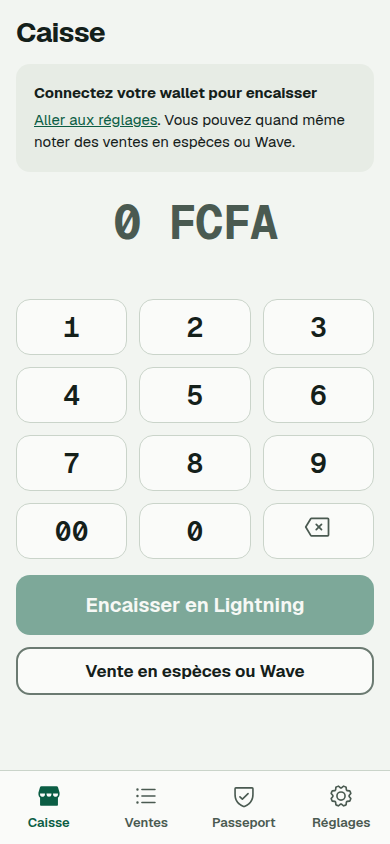
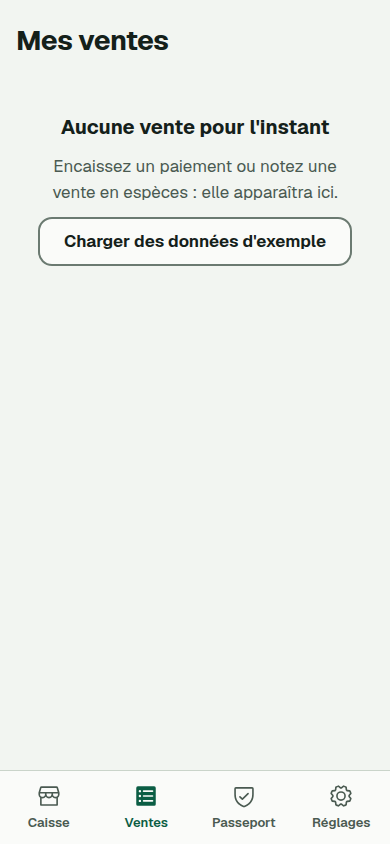
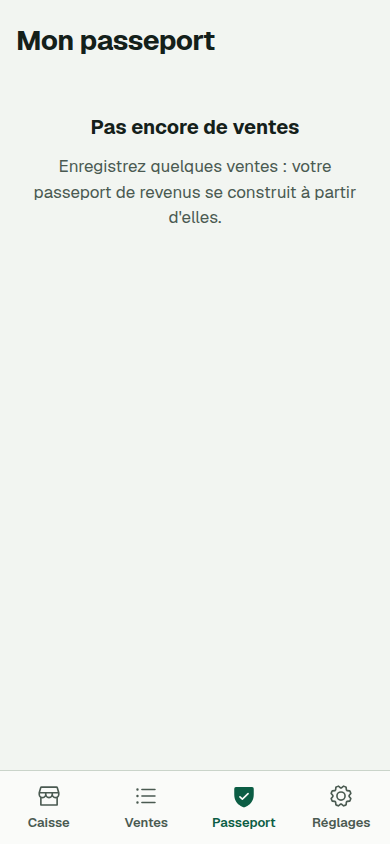
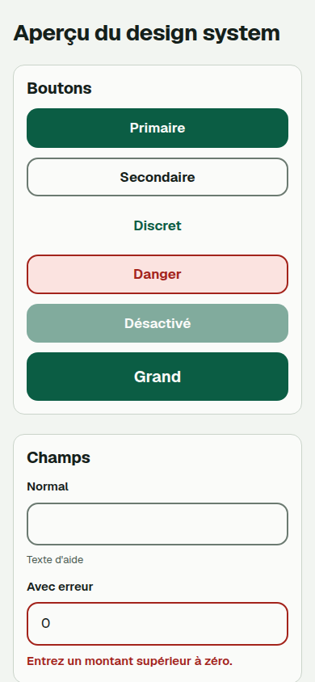

# Écrans de l'application mobile

État réel de l'application au **18 novembre 2026** (code dans `app/`). Le document [PARCOURS_ET_ECRANS.md](PARCOURS_ET_ECRANS.md) décrit la cible complète ; celui-ci dit ce qui existe, ce qui manque, et propose le découpage en issues.

## 1. Décision : PWA

**On fait une PWA** (application web installable), pas une application native.

| Critère | PWA | Application native (Android/iOS) |
|---|---|---|
| Délai avant le 20 nov, 21h | **Tenable** : le code existe déjà | Non tenable en deux jours |
| Installation | Un lien, puis « Ajouter à l'écran d'accueil » : aucun store, aucune validation | Store, compte développeur, délais de validation |
| Critère du jury « installation en une commande » | Compatible (`docker compose up`, ou lien déployé) | Plus lourd |
| Appareils cibles (smartphone d'entrée ou moyenne gamme) | Marche sur tout navigateur récent, poids léger (150 ko de JavaScript compressé) | Dépend de la version du système |
| Wallet Lightning | NWC passe par des WebSockets : fonctionne dans le navigateur | Idem |
| Hors ligne | Possible avec un service worker (à ajouter) | Natif |
| Lien du passeport pour l'agent de microfinance | Une simple page web, **sans installation** : c'est un atout décisif | Il faudrait installer une application |

**Limites à assumer**
- iOS : pas de bouton d'installation automatique, il faut passer par le menu « Partager » de Safari. Les vibrations ne sont pas prises en charge sur iPhone.
- Le lien de connexion du wallet et la clé de signature sont dans le stockage du navigateur. Un navigateur effacé fait perdre la clé : la phrase de secours est prévue dans la cible (écran C2) mais pas encore construite.
- État actuel : le manifeste et l'icône sont présents, **le service worker n'est pas encore écrit**. L'application ne fonctionne donc pas encore hors connexion au démarrage.

**Prochaine étape si le projet continue** : envelopper la PWA avec Capacitor pour la publier sur Android, sans réécrire l'interface.

## 2. Plan des écrans

```
Commerçant :  barre du bas, 4 onglets
  Caisse ──┬─ (QR en attente) ─ (Paiement reçu)
           └─ Vente en espèces ou Wave
  Ventes (historique)
  Passeport ── lien et QR partageables
  Réglages

Agent de microfinance : page ouverte par lien, sans navigation
  Vue prêteur   (#/preteur/<passeport>)

Interne : Aperçu du design system   (#/apercu-design-system)
```

Routage par hash (`#/…`) : le lien du passeport fonctionne sans serveur ni règle de réécriture d'URL.

## 3. Écrans existants

Légende de l'état : **fait** (codé et vérifié visuellement ou par test), **codé** (écrit, à tester avec un vrai wallet).

### Caisse (`#/`) : [Caisse.tsx](../app/src/pages/Caisse.tsx)


- **But** : encaisser un paiement Lightning.
- **Contenu** : montant en FCFA (grand), équivalent en sats en secondaire, pavé numérique, deux boutons (« Encaisser en Lightning », « Vente en espèces ou Wave »).
- **Phases** : saisie, création de la facture, attente (QR), paiement reçu, erreur.
- **États gérés** : wallet non connecté (bandeau vers les réglages), cours de change en chargement, cours indisponible, cours en cache (« dernier cours connu »), mode démonstration signalé, montant plafonné à 10 000 000 FCFA, facture expirée, annulation.
- **État** : phases et mise en page **faites** ; paiement réel **codé**, non testé avec Alby Hub ou LNbits.

### Vente en espèces ou Wave (`#/declarer`) : [Declarer.tsx](../app/src/pages/Declarer.tsx)
- **But** : noter une vente qui n'est pas passée par Lightning.
- **Parcours** : l'utilisateur écrit « 2 sacs de riz, 15 000 », l'analyse propose un article et un montant, il vérifie ou corrige, puis enregistre. La vente est marquée « Déclaré ».
- **Règle** : la confirmation est **toujours** obligatoire (un montant mal compris est une erreur d'argent).
- **Limite** : l'analyse est une règle locale (le dernier nombre est le montant), pas un modèle d'IA.
- **État** : **fait**, analyse testée sur 4 formulations.

### Mes ventes (`#/historique`) : [Historique.tsx](../app/src/pages/Historique.tsx)


- **Contenu** : total prouvé, total déclaré, liste regroupée par jour, chaque ligne avec pastille « Prouvé » ou « Déclaré » et heure ; export en fichier CSV.
- **État vide** : message et bouton « Charger des données d'exemple » (ventes déclarées uniquement, jamais de fausse preuve Lightning).
- **État** : **fait**.

### Mon passeport (`#/passeport`) : [Passeport.tsx](../app/src/pages/Passeport.tsx)


- **Contenu** : choix de la période (7, 30, 90 jours), total avec la part prouvée et la part déclarée, bouton « Générer mon passeport ».
- **Résultat** : relevé signé avec la clé Nostr du commerçant, lien partageable, QR code (seulement si le lien est assez court pour être scanné fiablement), bouton « Copier le lien ».
- **État vide** : explique qu'il faut d'abord enregistrer des ventes.
- **État** : **fait**.

### Vue prêteur (`#/preteur/<passeport>`) : [VuePreteur.tsx](../app/src/pages/VuePreteur.tsx)
- **Pour qui** : l'agent de microfinance. Aucun compte, aucune installation.
- **Contenu** : signature valide ou invalide, total sur la période, total prouvé (nombre de paiements vérifiés) et total déclaré, preuves rejetées, plafond de prêt indicatif (20 % du flux mensuel estimé, avec et sans les ventes déclarées), liste de ce qui a été vérifié et de ce qui ne l'est pas.
- **États** : chargement, lien illisible, signature invalide.
- **État** : **fait**. Testé : signature valide, falsification détectée, fausse préimage rejetée, aller-retour du lien.
- **Limite affichée à l'écran** : un commerçant peut se payer lui-même, les ventes déclarées reposent sur sa parole.

### Réglages (`#/reglages`) : [Reglages.tsx](../app/src/pages/Reglages.tsx)
- **Contenu** : connexion du wallet (champ masqué, ou mode démonstration), déconnexion, identité de signature (début de la clé publique), effacement des ventes avec confirmation.
- **État** : **fait** ; connexion NWC réelle **codée**, non testée.

### Aperçu du design system (`#/apercu-design-system`) : [ApercuDesignSystem.tsx](../app/src/pages/ApercuDesignSystem.tsx)


- **But** : contrat visuel interne, toutes les primitives dans tous leurs états. À ouvrir en clair et en sombre avant de toucher aux tokens.
- **État** : **fait**.

## 4. Écrans prévus et non construits

| ID | Écran | Pourquoi il compte |
|---|---|---|
| C0 | Bienvenue | Premier contact : une promesse en une phrase |
| C1 | Connexion du wallet guidée | Aujourd'hui, un champ seul, sans aide à la copie du lien |
| C2 | Sauvegarde de la clé (phrase de secours) | Sans elle, un navigateur effacé fait perdre l'identité de signature |
| C8 | Détail d'une vente | Statut de preuve, contresignature, renvoi du reçu |
| C9 | Résumé du jour | Phrase générée, chiffres clés |
| C12 / C13 | Mon équipe, ajouter un vendeur | Budgets NWC plafonnés et révocables (argument « sécurité by design ») |
| V1 | Caisse vendeur | Caisse simplifiée, budget restant |
| P1 | Reçu client avec contresignature | Rend la fabrication de faux clients plus coûteuse |

## 5. Transversal à faire

- Service worker et usage hors ligne au démarrage.
- Test avec un vrai wallet (Alby Hub ou LNbits) : création de facture, détection du paiement, préimage.
- Dépôt de démonstration : `docker compose up` et données d'exemple.
- Accessibilité : passage au clavier et lecteur d'écran sur tous les écrans, test sur un téléphone d'entrée de gamme.
- Tests de bout en bout (parcours caisse, passeport, vue prêteur).
- Déploiement : front sur Vercel avec dépôt privé ou lien public du build.

## 6. Issues proposées

Aucune issue n'est créée tant que ce découpage n'est pas validé. Étiquettes : `mvp` (à livrer pour le 20 nov), `bonus`, `docs`, `securite`. Ordre = priorité.

| # | Titre | Étiquettes | Contenu |
|---|---|---|---|
| 1 | Tester la caisse avec un vrai wallet NWC | `mvp` | Alby Hub ou LNbits : facture, détection du paiement, préimage enregistrée. Corriger ce qui casse |
| 2 | Service worker et usage hors ligne | `mvp` | Mise en cache de l'application, démarrage sans connexion, mémorisation du cours |
| 3 | Déployer la PWA et vérifier l'installation sur téléphone | `mvp` | Lien public, test Android et iOS, icônes |
| 4 | Écran de sauvegarde de la clé (C2) | `mvp`, `securite` | Phrase de secours, restauration |
| 5 | Modèle de menace dans le README | `mvp`, `docs`, `securite` | Fraude par auto-paiement, vol de clé, lien NWC dans le navigateur, fausse contresignature |
| 6 | Connexion du wallet guidée (C1) | `mvp` | Aide à la copie, test de connexion, message d'erreur actionnable |
| 7 | `docker compose up` avec données d'exemple | `mvp` | Exigence du jury |
| 8 | Schéma d'architecture | `mvp`, `docs` | Dans le README |
| 9 | Vidéo de démo de 3 minutes | `mvp`, `docs` | Ouverture sur le chiffre 20,3 % contre plus de 30 % par mois |
| 10 | Contresignature client et reçu (P1) | `bonus` | Reçu Nostr chiffré, signature du client, comptage « contresigné » dans la vue prêteur |
| 11 | Budgets vendeurs NWC (C12, C13, V1) | `bonus`, `securite` | Plafond journalier, révocation |
| 12 | Résumé du jour par IA (C9) | `bonus` | Phrase en français simple |
| 13 | Analyse des ventes par Claude, côté serveur | `bonus` | Remplace la règle locale, sans clé d'API dans le navigateur |
| 14 | Détail d'une vente (C8) et écran de bienvenue (C0) | `bonus` | |
| 15 | Passage accessibilité et téléphone d'entrée de gamme | `mvp` | Clavier, lecteur d'écran, contraste vérifié sur appareil |
| 16 | Tests de bout en bout des parcours principaux | `bonus` | Caisse, passeport, vue prêteur |
| 17 | Saisie vocale en wolof | `bonus` | Piste de la prochaine itération, à ne pas promettre pour le 20 nov |
